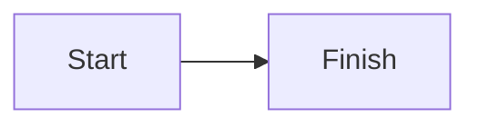

# Standalone HTML

Local animation

First reveal

Second reveal

<!--
HTML_EXPORT_PRIVATE_NOTE
-->

---

# Embedded media

<audio controls src="/tone.wav"></audio>

---

# Local interaction

<button id="offline-counter" @click="count++">Count: {{ count }}</button>

